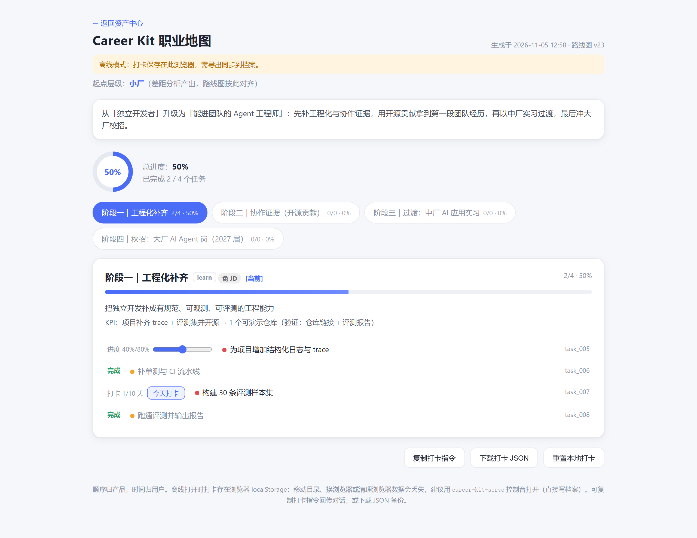

# Career Kit

English | [中文](README.md)

[](https://github.com/W7uuuuz/Career-kit/actions/workflows/ci.yml)
[](https://opensource.org/licenses/MIT)
[](https://www.python.org/downloads/)
[](https://modelcontextprotocol.io/)

> Stop mass-applying. Career Kit is an AI career coach MCP server: real job postings → gap analysis → staged roadmap → check-in tasks → application funnel review.

Works with Claude Code, Cursor, opencode, and Codex. It turns job hunting from "send resumes and hope" into a plan grounded in real market data and trackable over time.

**[Try the interactive career map](https://w7uuuuz.github.io/Career-kit/examples/demo/career-map.html)** · [Sample output](docs/examples/demo/) · [Docs](docs/README.md)



> The image above is a real artifact generated from a sample resume through the full pipeline. Check a task to log progress; the online demo requires no installation.

## Why it is different

- **Real data, not guesses**: pulls live postings from BOSS, ByteDance, Tencent, Baidu, Alibaba, Nowcoder, and GitHub experience threads. Gap analysis must cite real sources or it is rejected.
- **Staged tasks**: phases, milestones, and check-in tasks (once / daily / percent). Ask "what should I do next" at any time.
- **Application funnel**: track applied → screened → interview → offer with event-based accounting. A rejection after an interview still counts as an interview.
- **Weekly review**: a factual recap of check-ins, phases, and funnel changes, so you can resume after a break.
- **Interactive career map**: export a self-contained HTML file. Check tasks, watch progress update, persist locally.
- **Adapts to you**: getting an interview triggers a re-evaluation; switching goals turns completed work into capability evidence.
- **Order is the product's job; pace is yours**: no deadlines are imposed on tasks.

## Quick start

### Option 1: one command (recommended)

Requires [uv](https://docs.astral.sh/uv/).

```bash
uvx --from career-kit career-kit-doctor   # health check
uvx --from career-kit career-kit          # start the MCP server (stdio)
```

Register with your agent:

| Agent | Command |
|-------|---------|
| Claude Code | `claude mcp add career-kit -- uvx --from career-kit career-kit` |
| Codex CLI | `codex mcp add career-kit -- uvx --from career-kit career-kit` |
| opencode | add to `opencode.json`: `{"mcp": {"career-kit": {"type": "local", "command": ["uvx", "--from", "career-kit", "career-kit"], "enabled": true}}}` |
| Cursor / Windsurf | add an MCP server: command=`uvx`, args=`["--from", "career-kit", "career-kit"]` |

> Until the first PyPI release, use the source install below.

### Option 2: from source

```bash
git clone https://github.com/W7uuuuz/Career-kit.git
cd Career-kit
pip install -e .
```

Use the same interpreter that ran `pip install -e .` when registering:

```bash
claude mcp add career-kit -- <venv-python> -m src.server
codex mcp add career-kit -- <venv-python> -m src.server
```

### Option 3: install script

```bash
bash install.sh                 # macOS / Linux
powershell -ExecutionPolicy Bypass -File .\install.ps1   # Windows
```

### Local console (optional)

```bash
career-kit-serve --open
```

Binds to `127.0.0.1` only. View the roadmap, task instructions, resources, and done criteria; check in directly; edit tasks and record applications. Data is written to the same SQLite profile the MCP server reads.

### Verify

```bash
career-kit-doctor
```

Then ask your agent to call `start_session`.

## Try it in 60 seconds (no install)

- **Online**: open the [interactive career map](https://w7uuuuz.github.io/Career-kit/examples/demo/career-map.html) and check a task.
- **Local**: open `docs/examples/demo/career-map.html`, or run `career-kit-demo` after installing.
- Full pipeline sample: `docs/examples/demo/` contains the roadmap, progress dashboard, and raw profile.

## How it works

```
You: I want to move into AI Agent engineering.
Career Kit: gap analysis → fetch real postings → design a roadmap → break it into staged tasks

You: I don't know what to do. Help me choose a direction.
Career Kit: three-axis positioning (skills × interests × real market data) → candidate directions → pick one

You: Done with this step.
Career Kit: check-in → capability evidence → automatic phase audit

You: I got a big-tech interview.
Career Kit: event-triggered insight → re-evaluate the plan → adjust tasks
```

Under the hood: 41 MCP tools covering onboarding, profile management, data acquisition (including market research), analysis and planning, tasks and funnel, and insight generation. See [tools.md](docs/tools.md).

## Privacy and boundaries

- Data stays local: `~/.career-kit/` for program data, `~/CareerKit/` for reports and roadmaps. Nothing is sent to an external server.
- Scraping only reads public job and interview pages. Respect each site's terms and rate limits. No referrals, no guaranteed offers. See [DISCLAIMER.md](DISCLAIMER.md).

## Documentation

- [Documentation map](docs/README.md)
- [LLM usage guide](docs/llms.txt)
- [Workflow](docs/workflow.md)
- [Tools](docs/tools.md)
- [Data sources](docs/scrapers.md)
- [Knowledge base](docs/knowledge.md)
- [Examples](docs/examples/README.md)
- [Contributing](CONTRIBUTING.md) · [Code of Conduct](CODE_OF_CONDUCT.md) · [Security](SECURITY.md)

## Who it is for

- **Good fit**: you are job hunting or switching careers, you use an AI coding agent, and you want a plan grounded in real postings that you can track over time.
- **Not yet**: you have no command-line experience. The current form requires Python and MCP registration.

## Contributing

Issues, PRs, and new company data sources are welcome. Read [CONTRIBUTING.md](CONTRIBUTING.md) first; new scrapers can start from `src/scrapers/_template/`.

If this project saves you time, a star helps more job seekers find it.

## License

MIT
