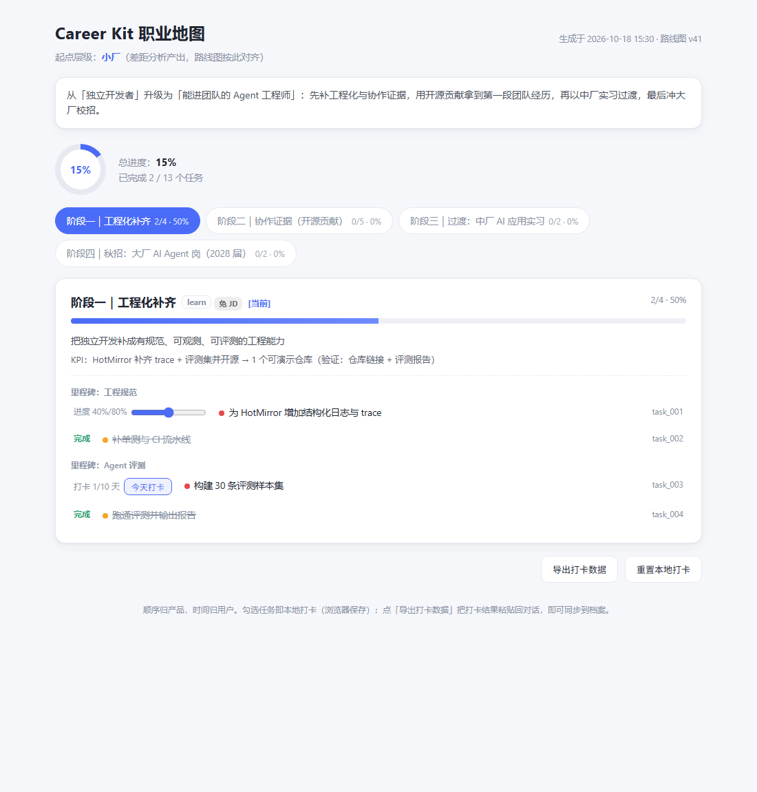
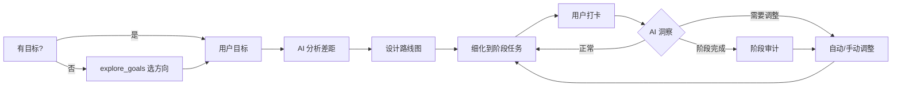

# Career Kit

[](https://opensource.org/licenses/MIT)
[](https://www.python.org/downloads/)
[](https://modelcontextprotocol.io/)

> 别再海投了。AI 帮你规划路线、打卡执行、达成目标。

**Career Kit 是一个 MCP 服务**——接入 Claude Code / Cursor / opencode 等任意支持 MCP 的 AI Agent，
把你的求职从「投简历碰运气」变成「有真实数据支撑的分阶段计划 + 可打卡执行」。



> 上图是 `docs/examples/demo/career-map.html` 的真实截图——一份样例简历经完整链路生成的
> **可交互职业地图**（勾选打卡、进度实时更新、本地保存）。无需安装，双击即可打开体验。

## 30 秒看懂

- **真实数据，不瞎分析**：接入 BOSS 直聘 / 字节跳动 / 牛客网的真实岗位数据，AI 基于市场真实要求
  分析差距，不凭空想象；差距必须锚定真实数据来源，否则被硬门禁拒绝。
- **拆成阶段任务**：不只是给一个大方向——分阶段、里程碑、可打卡任务（按次/按天/按比例），
  随时问「下一步做什么」。
- **可交互职业地图**：一键导出自包含 HTML，勾选即打卡、进度实时更新、浏览器本地保存。
- **跟着你变，不是死计划**：拿到面试触发洞察重估；换目标时已完成进度自动沉淀为能力证据。
- **顺序归产品，时间归用户**：只为任务定义顺序与完成标准，不为它设时限。

## 快速开始

### 一键安装（推荐）

```bash
# macOS / Linux
bash install.sh

# Windows PowerShell
powershell -ExecutionPolicy Bypass -File .\install.ps1
```

脚本会建好 `.venv`、装好依赖，并直接打印注册命令——**用绝对解释器路径**，
避开「裸 `python` 指到错误解释器」的经典坑。

### 手动安装

```bash
git clone https://github.com/W7uuuuz/Career-kit.git
cd Career-kit
pip install -e .
```

> **解释器很重要**：注册命令里的 `python` 必须是执行过 `pip install -e .` 的那一个。
> 本机存在多个 Python 时，裸 `python` 可能指向缺依赖的解释器。最稳妥是 venv 绝对路径：
> `D:\path\to\Career-kit\.venv\Scripts\python.exe`（Windows）或 `.venv/bin/python`（macOS/Linux）。

### 注册到你的 AI Agent

| Agent | 注册方式 |
|-------|---------|
| Claude Code | `claude mcp add career-kit -- <venv-python> -m src.server` |
| Codex CLI | `codex mcp add career-kit -- <venv-python> -m src.server` |
| opencode | `opencode.json` 中加入：`{"mcp": {"career-kit": {"type": "local", "command": ["<venv-python>", "-m", "src.server"], "enabled": true}}}` |
| Cursor / Windsurf | MCP 设置中手动添加：command=`<venv-python>`，args=`["-m", "src.server"]` |

> macOS 用户把 python 换成 python3。

### 验证安装

对新会话说「调用 start_session」，或直接敲 `/career-kit`——
收到「欢迎使用 Career Kit」欢迎手册即接入成功。

### 故障排查

| 现象 | 处理 |
|------|------|
| 工具列表里没有 career-kit 的工具 | 确认注册命令在 Career-kit 目录下执行；Claude Code 会话内用 `/mcp` 查看连接状态 |
| 服务器启动即崩 / `No module named 'mcp'` | 注册用了错误解释器——改用 venv 绝对路径（见上方警告） |
| 抓取工具报 Playwright 相关错误 | 先执行 `playwright install chromium` 安装浏览器内核 |
| BOSS 直聘提示需要登录 | 在项目目录运行 `python -m src.scrapers.boss.login`，浏览器弹出后扫码即可——检测到登录态自动保存退出 |
| uv 装依赖报 `iv8 was not found` | iv8 只在官方 PyPI，不在镜像上：`uv pip install -e . --index-url https://pypi.org/simple` |

### 斜杠命令（可选）

- **Claude Code**：仓库已内置 `/career-kit [目标]`（职业陪练）与 `/career-kit-profile`（档案管理）——
  在本目录启动 claude 即可直接使用；想在任意目录用，复制到全局：
  `mkdir -p ~/.claude/commands && cp .claude/commands/*.md ~/.claude/commands/`
- **opencode**：同理内置 `.opencode/commands/career-kit.md` 与 `.opencode/commands/career-kit-profile.md`；
  全局版复制到 `~/.config/opencode/commands/`
- **Codex CLI**：把 `.claude/commands/*.md` 复制为 `~/.codex/prompts/`，即可用 `/prompts:career-kit` 调用

## 它能做什么？

```
你：我想转 AI Agent 方向
Career Kit：分析差距 → 拉取真实岗位数据 → 设计路线图 → 拆成阶段任务

你：我不知道想做什么，帮我选个方向
Career Kit：三轴定位（你的能力 × 你的兴趣 × 真实岗位数据）→ 提出 2-3 个候选方向
          → 对话引导你选定 → 走差距分析

你：这步做完了
Career Kit：打卡记录 → 完成即沉淀能力证据 → 阶段完成自动触发审计

你：我拿到大厂面试了
Career Kit：事件触发洞察 → 重估计划 → 调整阶段任务
```

## 核心流程



## 为什么是它？

| | ChatGPT | 求职网站 | Career Kit |
|---|---------|----------|------------|
| 真实岗位数据 | 无 | 有 | 有（可抓取，含薪资） |
| 个性化路线图 | 泛泛而谈 | 无 | 分阶段 + 里程碑 + 完成标准 |
| 阶段任务打卡 | 无 | 无 | 有（按次/按天/按比例） |
| 进度追踪调整 | 无 | 无 | 阶段审计 + 事件洞察 |
| 数据本地、可自托管 | 否 | 否 | 是 |

## MCP 工具（32 个）

### 建档与分析

| 工具 | 作用 |
|------|------|
| `start_session` | 初始化新的职业规划会话 |
| `parse_resume` / `intake` / `finalize_profile` | 简历解析、逐步填充档案、确认档案（含技能摸排硬门禁） |
| `import_jd` / `import_jd_file` | 导入目标 JD（文本/文件） |
| `list_profiles` / `switch_profile` / `delete_profile` / `list_trash` / `restore_profile` | 多档案管理（回收站式删除） |
| `explore_goals` | 无目标时三轴定位引导选方向 |
| `list_data_sources` / `fetch_company_jobs` / `fetch_jd_detail` | 真实岗位数据源与抓取 |
| `search_knowledge` | 检索本地知识库（爬虫自动积累的 JD/面经） |
| `analyze_gaps` / `save_gap_analysis` | 差距分析（含内容质量门：不编造） |

### 规划与执行

| 工具 | 作用 |
|------|------|
| `generate_roadmap` / `save_roadmap` | 生成/保存分阶段路线图（起点判定 + 层级连续 + 届别硬校验） |
| `import_plan` | 导入既有计划 |
| `generate_tasks` / `detail_current_phase` / `save_current_detail` | 生成任务、按需细化当前阶段打卡点 |
| `get_next_tasks` / `checkin_task` / `get_progress` | 下一步任务、打卡、进度概览 |

### 洞察与产出

| 工具 | 作用 |
|------|------|
| `trigger_insight` / `apply_insight` | 阶段审计 / 事件洞察与应用调整 |
| `get_workflow_status` | 工作流状态 + 目标变更检测 |
| `export_dashboard` | 生成自包含 HTML：进度仪表盘 / 可交互职业地图 |

## 文档

- [LLM 使用指南](llms.txt)：工作流、工具分类、常见场景
- [工作流详解](docs/workflow.md)：完整工作流、前置条件、输入输出
- [企业库](docs/scrapers.md)：已收录企业、数据源说明
- [工具总览](docs/tools.md)：MCP 工具列表、分类说明
- [知识库](docs/knowledge.md)：目录结构、文件格式
- [示例](docs/examples/README.md)：完整工作流示例、场景示例
- [零等待演示](docs/examples/demo/README.md)：一份真实产出（简历 → 职业地图）

## 隐私

所有数据存储在本地 `~/.career-kit/`，不会发送到任何外部服务器。
知识库是用户自有资产，不随包升级丢失。

## 开源协议

MIT
